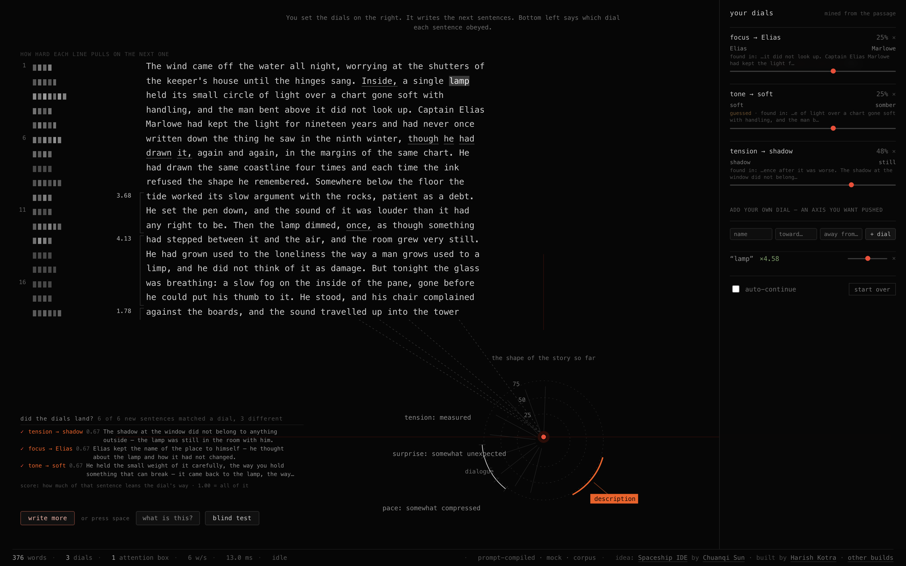
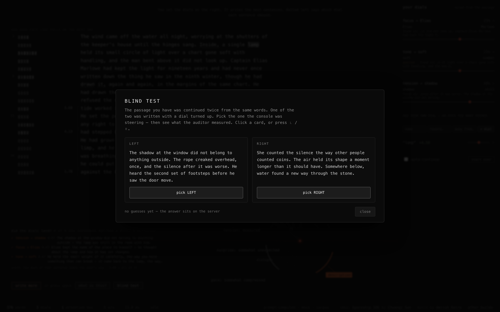
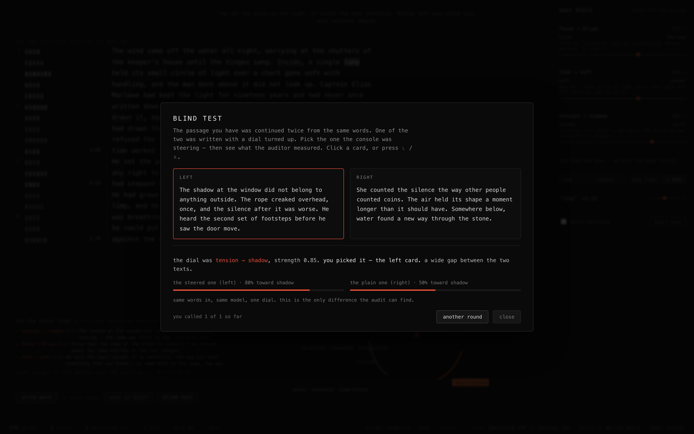

# steer

**A live vector-steering console for prose — with an audit that checks whether the steering actually landed.**

> **Built on [Spaceship IDE](https://github.com/chuanqisun/spaceship) by [Chuanqi Sun](https://chuanqisun.com) (MIT Media Lab).** His demo is the original "steer your ideas in realtime" idea and the source of every interaction here. This project is an independent implementation that adds a measurement loop, and a [blind test](#the-blind-test) you can lose — see [Credits](#credits).

Text streams into a dark writing surface. Every line on the left is scored by how hard it pulls on the sentence that follows. The dials on the right are not a fixed menu: they are **mined from the passage you already have**, each one carrying the sentence that justified it. Select a phrase and it becomes an *attention box* the next paragraph has to lean on. Then, bottom left, the console tells you the truth: which dial each new sentence actually obeyed, and `unclaimed` for the sentences that obeyed none. When you want the same question answered by a human, **blind test** deals two continuations — one steered, one not — and scores your guess.

It ships with three backends: a zero-credential `mock` corpus, a `prompt-compiled` mode for any OpenAI-compatible API, and real activation steering on local weights with Apple MLX.



```
pip install -e ".[dev]"
steer
```

Open <http://127.0.0.1:7860>. No keys, no downloads, nothing to configure.

- Read the walkthrough: [Using it](#using-it)
- The deep technical write-up: [`docs/blog.md`](docs/blog.md)
- Launch copy: [`docs/launch.md`](docs/launch.md)

---

## Table of contents

1. [What it does](#what-it-does)
2. [Using it](#using-it)
3. [Architecture](#architecture)
4. [How the mechanisms work](#how-the-mechanisms-work)
   - [Vectors are mined, not predefined](#1-vectors-are-mined-not-predefined)
   - [Real activation steering](#2-real-activation-steering-local-weights)
   - [Attention boxes](#3-attention-boxes)
   - [The measurement loop](#4-the-measurement-loop)
   - [The rail reads forward](#5-the-rail-reads-forward)
5. [Three backends, one console](#three-backends-one-console)
6. [The blind test](#the-blind-test)
7. [The WebSocket protocol](#the-websocket-protocol)
8. [Tech stack](#tech-stack)
9. [Measured numbers](#measured-numbers)
10. [Repo layout](#repo-layout)
11. [Running and testing](#running-and-testing)
12. [Contributing](#contributing)
13. [Roadmap: features worth adding](#roadmap-features-worth-adding)
14. [Known limits](#known-limits)
15. [Credits](#credits)
16. [License](#license)

---

## What it does

Four claims from **[Spaceship IDE](https://github.com/chuanqisun/spaceship) by Chuanqi Sun** — first met through the reel *Realtime LLM Vector Steering* (@far\_\_\_behind) — are each a mechanism here, not a visual effect:

| the claim | what actually runs |
|---|---|
| vectors are **contextual, live-generated** from the story, not a predefined set | [`steer/propose.py`](steer/propose.py) mines axes out of the passage: the people it names, the register it already sits in. Detector word-lists decide only *which side* the passage is on — the pole word and the justifying span come from your text and are printed under each dial |
| **attention boxes**: the next text leans on the words you pick | under `mlx` a box is a contrastive hidden-state offset, `h(with span) − h(without span)`; under `mock` a corpus preference; under `api` a directive. All three are then **measured** over the text written after the box was placed → `×N` in the panel |
| the rail shows **attention to what comes next** | every clause is scored by how many of its words later sentences pick up ([`attention_to_next`](steer/auditor.py)) — not by how important it looked in isolation |
| **verification**: "we detected three sentences, each realizing one vector" | [`auditor.verify`](steer/auditor.py) attributes each recent sentence to at most one vector with the share that earned it, and leaves the rest explicitly unclaimed |

**The audit is allowed to fail.** A dial that does nothing produces `unattested` poles, `×1.0` boxes and `0 of N new sentences matched a dial`. Shipping the measurement next to the controls is the point; a console that always reports success is a demo, not an instrument.

That audit answers *did the vector land in this text*. The **[blind test](#the-blind-test)** answers the harder question: can a reader feel it without being told? Two continuations, one dial at `0.85`, one guess, and a reveal that scores both texts on the axis that was pushed — `you called it 3 of 4`.

Typical state after ~400 words with one box and three live axes (mock provider, measured in a browser):

```
did the dials land? 6 of 6 new sentences matched a dial, 3 different
  ✓ tension → muscle  0.67  The rope creaked overhead, once, and the silence after it was worse.
  ✓ tone → warm       0.67  She said his name once, quietly, and the room forgave them both.
  ✓ focus → Elias     0.60  Elias counted the stair treads without meaning to.

box "lamp"   lift ×4.07   held
```

Same console on real weights (`--provider mlx`, Qwen2.5-3B, layer 19, box on `lamp`):

```
did the dials land? 4 of 6 new sentences matched a dial, 2 different
box "lamp"   lift ×3.2   held
```

Two sentences were left unclaimed, and that is what the run reported. A claim is only made when one vector's share clears `0.55` at sentence level.

---

## Using it

1. **Space** (or **write more**) appends sentences to the passage.
2. **Left rail** — line numbers and block bars: how hard each line pulls on what follows. Long bar = a detail the text keeps returning to.
3. **Right dock** — your dials. Each shows the axis, both poles, the current strength, and a quote from the passage underneath. Click the quote and the console scrolls to and flashes that sentence. Drag a dial to push the next paragraph one way or the other.
4. **Select prose** → an attention box. The next paragraph is written around those words, and the box row reports `×N` once it has been tested.
5. **Bottom left** — the audit. Click any claim to see the sentence it is talking about.
6. **The ring** — tension, surprise, pace, dialogue/description for the passage so far. It describes; it is not a control.

`what is this?` replays the guided tour. `Tab` folds the dock away. `start over` throws the story away and re-seeds from the passage.

### What a first run actually looked like

I drove the UI in a headless Chrome over CDP instead of trusting the screenshot, and the first version was broken in ways a still image cannot show:

| symptom | cause | fix |
|---|---|---|
| dials invisible on load | dock was opt-in behind `Tab` | dock is visible by default, `?fold=1` is the opt-out |
| **space did nothing** on a fresh page | a generation whose browser vanished held an in-process flag forever | guard is time-boxed (`gen_since`, 25 s) and cleared when the owning socket closes |
| auto-continue wrote before you could touch a dial | it started on socket open | opens on the seed passage and waits for you; auto-continue is off by default |
| dragging a dial renamed it `tone → plus` | label used a field name | label reads the real pole (`tone → soft`) |
| the rack re-ordered mid-drag | re-proposal appended instead of preserving order | order held across every re-proposal |
| audit rows unclickable and clipped | `pointer-events: none`, single-line rows | rows wrap, are click targets, open their sentence |
| box reported `×0.01` | divide-by-epsilon when the box was never tested | `no pull yet` until measured, then a real ratio |
| box injected "nothing about the *until* had been decided yet" | the box clause used any word longer than 3 characters | stop-words and participles filtered, longest content word used |
| text ran together (`the silenceThe latch clicked`, `inhabitedthe shadows`) | per-token detokenisation on both providers | sentence terminators enforced; MLX decodes the whole suffix and diffs it |
| chart spokes and a full-height rule crossed the paragraph | overlay leaders drawn from the text | leaders start below the roll; the vertical guide is a short connector |
| last line clipped by half a line-height | scroll math rounded down | padded by `lh * 1.6` |

All of it is behavioural. The screenshots looked fine; using it did not.

---

## Architecture

No frontend build step, no bundler, no node. One FastAPI process, one WebSocket, one hand-written client.

```
┌────────────────────────────── browser (static, no build) ──────────────────────────────┐
│  index.html · console.css · console.js                                                 │
│    #roll / #rail / #prose      #dock (dials + provenance)      #ledger (the audit)     │
│    #overlay <svg> (rail, leaders, radial dial)                 #status (plain words)   │
└───────────────────────────────────────┬────────────────────────────────────────────────┘
                     WS /ws  ── cmds ↓ ── │ ── ↑ init · state · delta · vectors · audit    │
┌───────────────────────────────────────┴────────────────────────────────────────────────┐
│  server.py — FastAPI + uvicorn                                                         │
│                                                                                        │
│   _generate(sock, console, provider, tokens)      _vector_cmd / _box_cmd                │
│        │  every chunk → {"type":"delta"}                │                              │
│        │  every 220 chars → _seed_vectors() ────────────┤                              │
│        │  every 140 ms  → auditor.audit() ──────────────┤                              │
│        ▼                                                ▼                              │
│   providers/                                     state.py                              │
│     mock  corpus pool, biased by active poles     Console (doc, vectors, boxes, pins)   │
│     api   directive() → OpenAI-compatible        SteerVector (poles, magnitude, delta)  │
│     mlx   hidden-state offset via a layer hook   AttentionBox (span, weight)            │
│        │                                                                               │
│        └── propose.py  mine axes from the passage                                      │
│            lexicon.py  scoring vocabulary · auditor.py  the measurement loop            │
└────────────────────────────────────────────────────────────────────────────────────────┘
```

**One generate cycle, end to end:**

1. Client sends `{"cmd":"generate","tokens":150}`.
2. `_generate` records `gen_at` (where this session's text starts — box lift is only measured after this) and sets `generating`.
3. `provider.stream(console)` yields chunks. Each chunk is appended to `console.doc` and forwarded as a `delta` frame.
4. Every ~220 new characters the axes are re-mined from the grown passage and pushed as a `vectors` frame — the dial belongs to the user, so a magnitude already set is carried forward.
5. Every ~140 ms a full `audit` frame goes out: rail scores, metrics, per-vector evidence, per-sentence verification, box lift.
6. On completion (or stop) a final audit and a `status: generating false` frame are sent, and the guard is released.

State lives in exactly one place — `Console` in `state.py` — and both the generation loop and the audit read from it. There is no second copy to drift.

---

## How the mechanisms work

### 1. Vectors are mined, not predefined

The console cannot steer toward something your passage has not earned. `propose.py` reads the text and returns only axes it can justify:

```python
def register_axis(doc: str, label: str) -> dict | None:
    reg = REGISTERS[label]
    plus_hits = attested(doc, reg["plus"])
    minus_hits = attested(doc, reg["minus"])
    if not plus_hits and not minus_hits:
        return None

    # the story's own words name the poles; the detector only ranked them
    plus = plus_hits[0] if plus_hits else reg["labels"][0]
    minus = minus_hits[0] if minus_hits else reg["labels"][1]
    both = bool(plus_hits and minus_hits)
    return {
        "label": label,
        "plus": plus,
        "minus": minus,
        "attested": both,                    # False when only one side is in the text
        "source": _evidence(doc, plus if plus_hits else minus_hits[0]),
        "found": {"plus": plus_hits[:4], "minus": minus_hits[:4]},
    }
```

Three consequences that matter:

- **The pole word is yours.** If your lighthouse story says *muscle*, the dial reads `tension → muscle`, not `tension → tense`. The detector list only decides which side.
- **`source` is mandatory.** Every dial carries the span that justified it, which the UI shows and makes clickable. A dial you cannot trace is a dial you should not trust.
- **One-sided axes are flagged, not invented.** `attested: False` means the passage only argued for one end; the console says so instead of pretending both poles were observed.

Focus is mined the same way — proper nouns that are not sentence-openers, most frequent first:

```python
def focus_axis(doc: str) -> dict | None:
    ens = names(doc)                 # "Elias" appears 9 times, not once
    you = first_person(doc)
    if not ens:
        return None
    top, count = ens[0]
    if you >= max(2, count // 2):
        minus, source = "narrator", _evidence(doc, top)
    elif len(ens) > 1:
        minus, source = ens[1][0], _evidence(doc, top)
    else:
        return None
    return {"label": "focus", "plus": top, "minus": minus,
            "attested": True, "source": source, ...}
```

`propose()` refuses to propose anything at all below 18 words — a rack mined from two sentences is noise pretending to be insight.

### 2. Real activation steering (local weights)

Under `--provider mlx` a dial does not become an instruction. It becomes a **difference between the model's own hidden states for two phrasings of the same context**, normalised, and added to a mid-depth layer on every forward pass:

```python
def build_delta(self, console: Console, vector, force: bool = False):
    ctx = steerer.anchor_text(console, 700)
    plus  = f"{ctx}\n\n> The narration now turns {vector.plus}. Next line:"
    minus = f"{ctx}\n\n> The narration now turns {vector.minus}. Next line:"

    h_plus  = self._hidden(plus)          # captured at layer 19
    h_minus = self._hidden(minus)
    d = h_plus - h_minus
    unit = d / (mx.linalg.norm(d) + 1e-6)

    # scale is a fraction of the layer's activation norm, not an absolute
    # number of nats — that is what keeps the dials meaningful across models
    d = unit * (self.scale * self._ref_norm)
    self._built[(vector.plus, vector.minus)] = d
    return d
```

The offset is installed by patching the decoder layer's `__call__` once per process, and the hook reads a module-level table keyed by the layer instance:

```python
def _patch(cls) -> None:
    original = cls.__call__

    def call(self, *args, **kwargs):
        y = original(self, *args, **kwargs)
        hook = _HOOKS.get(id(self))
        if hook is not None:
            delta, capture = hook
            if delta is not None:
                y = y + delta           # the steer, inside the graph
            if capture is not None:
                capture.append(y)       # used to build the next delta
        return y

    cls.__call__ = call
```

Composition is a sum, and it is re-armed whenever the version counter changes — between chunks, not between requests:

```python
def arm(self, console: Console, rebuild: bool = False) -> None:
    """Install the combined offset: voice vectors and attention boxes."""
    total = None
    for v in console.active:
        term = self.build_delta(console, v, force=rebuild) * v.magnitude
        total = term if total is None else total + term
    for box in console.boxes:
        term = self.build_attention_delta(console, box, force=rebuild)
        total = term if total is None else total + term
    _HOOKS[id(self.layer)] = (total, None)
```

Because the offset is applied *inside* the forward pass and re-armed between decoded chunks, **moving a dial mid-stream steers the next token** — no restart, no prompt rewrite, no lost paragraph. That is the whole difference between this and prompting.

`self.net` is the weights; `self.model` is the display string. They collided once, in a way that quietly made every delta a string multiplication, and are now separate names on purpose.

### 3. Attention boxes

Select text and the span becomes a box with a weight. Under `mlx` it is an activation, not a hint:

```python
def build_attention_delta(self, console: Console, box, force: bool = False):
    ctx = steerer.anchor_text(console, 700)
    with_box = f"{ctx}\n\n> The next line keeps these words live: {box.text.strip()}\n\nNext line:"
    without  = f"{ctx}\n\nNext line:"
    d = self._hidden(with_box) - self._hidden(without)
    unit = d / (mx.linalg.norm(d) + 1e-6)

    # a box is an explicit instruction, not a suggestion, so its floor is
    # above the voice-vector default: weight 0.5 -> 1.0 * scale
    d = unit * (self.scale * (0.5 + max(0.0, box.weight)) * self._ref_norm)
    self._built[("attn", box.text.strip(), round(box.weight, 2))] = d
    return d
```

Boxes also enter the anchor prompt, and under `mock` they bias which corpus sentences are eligible — so all three backends at least try. What separates them is whether the attempt is measurable, and in every backend it is:

```python
def attention_lift(console, generated: str) -> list[dict]:
    """Did a box actually pull the next text toward its own words?"""
    after_terms  = [w.lower() for w in lexicon.words(generated)]
    before_terms = [w.lower() for w in lexicon.words(before)]
    for b in console.boxes:
        want = {w.lower() for w in lexicon.words(b.text) if len(w) > 3}
        hit_now, hit_before = ..., ...
        now  = hit_now / max(1, len(after_terms))
        prev = hit_before / max(1, len(before_terms)) if before_terms else 0.0
        # a box whose words never appear after it has not been tested, not
        # failed at 1%; report 0.0 so the UI can say "no pull yet"
        lift = 0.0 if hit_now == 0 else (now + 1e-4) / (prev + 1e-4)
```

`lift` is the share of the box's content words in the new text over their share in the passage before the box existed. Selecting the same span twice **updates** the existing box rather than stacking a duplicate — otherwise the panel shows the same box twice and the lift is counted against itself.

### 4. The measurement loop

The verdict the reel skips. Every recent sentence is attributed to at most one vector, or to nothing:

```python
def verify(console, tail_sentences: int = 6, floor: float = 0.55) -> dict:
    """Attribute each sentence to the vector it realizes, or to nothing."""
    sents = [s for s in re.split(r"(?<=[.!?])\s+", console.doc.strip()) if len(s.strip()) > 24]
    sents = sents[-tail_sentences:]

    claims, used = [], set()
    for s in sents:
        best, best_share = None, 0.0
        for v in console.active:
            plus_share, minus_share = lexicon.pair_score(s, expand(v.plus), expand(v.minus))
            share = plus_share if v.pole == v.plus else minus_share
            if share > best_share:
                best, best_share = v, share
        ok = best is not None and best_share >= floor
        claims.append({"sentence": s.strip()[:120],
                       "vector": best.label if ok else "",
                       "pole": best.pole if ok else "",
                       "share": round(best_share, 3),
                       "realized": ok})
    ...
    return {"claims": claims, "claimed": claimed, "counted": len(claims), "vectors": distinct,
            "note": f"{claimed} of {len(claims)} new sentences matched a dial…"}
```

`expand()` is what stops the audit from being a spell-check:

```python
def expand(pole: str) -> str:
    """A pole word plus the rest of its register.

    Verification asks "did the passage land on this side of the axis", not
    "did the exact word appear" — a tender sentence that says *steady care*
    instead of *soft* has still realized the vector, and an audit that misses
    it is measuring vocabulary rather than effect.
    """
```

Scoring is Laplace-smoothed and always sums to 1, so a single stray word cannot read as a 100% steer:

```python
def pair_score(text: str, plus: str, minus: str) -> tuple[float, float]:
    """Split the evidence between the two poles of one vector."""
    a, b = hits(plus), hits(minus)
    total = a + b + 2.0          # +1 each side: neutral text scores 0.5 / 0.5
    return (a + 1.0) / total, (b + 1.0) / total
```

An earlier version normalised only over tokens that matched *something*, which made `tender 92% / somber 8%` out of a paragraph that mentioned neither. The percentage now means what it looks like it means.

### 5. The rail reads forward

A line is scored by what it sets up, not by how intense it is:

```python
def attention_to_next(doc: str, start: int, end: int) -> float:
    """How strongly a span forecasts the text that follows it."""
    span, tail = doc[start:end], doc[end:]
    if len(tail.strip()) < 40:
        return 0.0
    planted = {w.lower() for w in lexicon.words(span) if len(w) > 3}
    if not planted:
        return 0.0
    picked = {w.lower() for w in lexicon.words(tail)}
    return len(planted & picked) / float(len(planted))
```

The displayed score is `0.75 * forward + 0.25 * recency`, so the newest lines are never blank while the measurement is still catching up. Those numbers are **relevance, not attention weights**, and the code never calls them attention weights. Calling a lexical score "attention" would be the exact dishonesty this project is about not doing.

---

## The blind test

Click **blind test** and the console deals you two continuations of the passage you have. Same words in, same model, same tokens — one of them was written with a dial turned up to `0.85`. You pick one. Then the auditor tells you what it measured.

```
the dial was tension → shadow, strength 0.85. you picked it — the left card. a wide gap between the two texts.
  the steered one (left)  · 80% toward shadow
  the plain one   (right) · 50% toward shadow
```





It exists because "does steering do anything?" is the only question worth asking of a steering console, and it is answerable. Spaceship's fourth conjecture explores alternative futures by scrubbing a single stream; this is the version you can lose at. If the two texts are indistinguishable, the console says so — `barely a gap` — and that is a result, not a bug.

Expect the gap to be uneven between backends. On the mock, whose corpus has real register separation, rounds come out `a wide gap` and the screenshots are from there. On MLX with a 3B model, three rounds on the same passage gave one `a real gap` (67 / 50) and two `barely a gap` (50 / 50): the steering is real, but a small model's prose does not always wear it on its sleeve. Publishing the flat rounds is the point — a game that always says `wide gap` would be measuring nothing.

How it stays honest:

- **The answer lives on the server.** `POST /api/blind` returns two texts and an axis, and parks the truth in `app.state.blind`. Nothing in the browser knows which side was steered until a guess arrives, so devtools get you nothing.
- **The pick is scored, not just correct/incorrect.** `POST /api/blind/{round}/{pick}` runs [`pair_score`](steer/lexicon.py) on both texts against the axis it used and reports each one's share toward the pushed pole.
- **Flat rounds are re-dealt.** The mock provider's corpus cannot express every pole. `deal()` makes four attempts, measures the gap on each, and keeps the widest one — a round nobody could win is a coin flip with a scripted verdict, and a round with no gap is reported as `barely a gap` rather than dressed up.

```python
# steer/blind.py
async def _future(provider, console, vector, tokens):
    c = _clone(console, vector)          # same passage, one knob
    await provider.prepare(c)
    start = len(c.doc)
    async for _ in provider.stream(c, max_tokens=tokens):
        pass
    return c.doc[start:].strip()          # only what this future wrote
```

Both futures stream for 70 tokens. Under `mock` a round takes about a second; under `mlx` it is two short generations, so give it ten. The tally in the corner (`you called it 3 of 4`) is the whole point: a steering technique a reader cannot feel is not a steering technique, it is a parameter.

---

## Three backends, one console

| provider | what the knobs do | needs | `activation` |
|---|---|---|---|
| `mock` (default) | picks continuations from a hand-written literary corpus, biased by the active poles and boxes | nothing | `false` |
| `api` | compiles vectors into a directive and sends it to any OpenAI-compatible endpoint | `STEER_API_KEY`, `STEER_API_BASE`, `STEER_API_MODEL` | `false` |
| `mlx` | computes a real contrastive direction in the hidden states and adds it to the residual stream | Apple silicon, `pip install -e ".[mlx]"` | `true` |

```bash
steer                                                          # mock, zero keys
steer --provider mock --seed keeper
steer --provider api  --model gpt-4o-mini
steer --provider mlx  --model mlx-community/Qwen2.5-3B-Instruct-4bit --layer 0.55 --scale 0.10
```

The status bar ends with `mock · corpus`, `api · gpt-4o-mini` or `mlx · Qwen2.5-3B-Instruct-4bit`, and under MLX it also reads `real activations`. Nothing pretends to be the other; `meta.activation` is the flag a client can key off, and the audit `note` is either `activation steering · layer 19` or `prompt-compiled`.

All three implement one Protocol:

```python
class Provider(Protocol):
    name: str
    model: str
    activation: bool

    def note(self) -> str: ...
    async def prepare(self, console: Console) -> None: ...
    def stream(self, console: Console, max_tokens: int) -> AsyncIterator[str]: ...
    async def stop(self) -> None: ...
```

---

## The WebSocket protocol

Client → server:

```jsonc
{"cmd":"generate","tokens":150}
{"cmd":"stop"}
{"cmd":"vector","action":"set","id":"v1","magnitude":-0.5}
{"cmd":"vector","action":"add","label":"weather","plus":"storm","minus":"calm"}
{"cmd":"vector","action":"remove","id":"v2"}
{"cmd":"box","action":"add","text":"the faded ink blot","start":10,"end":28,"weight":0.75}
{"cmd":"box","action":"weight","id":"b1","weight":1.1}
{"cmd":"box","action":"remove","id":"b1"}
{"cmd":"pin","id":"v2"}
{"cmd":"reset","seed":"keeper"}
```

Server → client: `init`, `state`, `delta`, `vectors`, `audit`, `status`, `error`.

Every `audit` frame is a complete measurement rather than an increment, so a client never has to reconstruct anything:

```jsonc
{
  "metrics": {"tension":{"value":0.81,"label":"very strained"}, "...":{}},
  "vectors": [{"id":"v1","label":"tone","pole":"soft","magnitude":0.7,"realized":0.64}],
  "segments": [{"start":412,"end":489,"score":0.71}],
  "attention": [{"id":"b1","text":"lamp","weight":0.75,"before":0.0008,"after":0.0345,"lift":4.07,"held":true}],
  "verification": {"claims":[{"sentence":"…","vector":"tone","pole":"warm","share":0.67,"realized":true}],
                   "claimed":6,"counted":6,"vectors":3,
                   "note":"6 of 6 new sentences matched a dial, 3 different"},
  "words": 471, "sentences": 24, "rate": 16.0, "latency_ms": 6.3, "note": "prompt-compiled"
}
```

`GET /api/state` returns the same thing plus `meta` — provider, model, activation flag, vector/box lists and the compiled directive. That is enough to drive a headless test or a second UI.

---

## Tech stack

| layer | choice | why |
|---|---|---|
| server | **FastAPI** + **uvicorn[standard]** | async generation loop, native WebSocket, one process, no worker model to reason about |
| transport | **WebSocket** (JSON frames) | a 140 ms audit cadence and token deltas need push, not polling |
| activation steering | **MLX** / **mlx-lm** | Apple silicon, unified memory, 4-bit Qwen2.5-3B loads in ~2 GB and streams at ~16 tok/s on an M4 |
| prompt path | **httpx** against any OpenAI-compatible `/chat/completions` | one code path for OpenAI, Groq, Together, OpenRouter, vLLM, Ollama |
| front end | **vanilla JS + CSS + SVG**, no build step | the whole client is ~680 lines and ships byte-for-byte as written; no toolchain to install to read it |
| state | **dataclasses** | three small mutable objects, one source of truth, trivially serialisable |
| tests | **pytest** + **httpx** `ASGITransport` + **websockets** | behaviour tests, not snapshot tests: a steer must move the prose |
| packaging | **setuptools** via **pyproject.toml**, `pip install -e` | installable CLI (`steer`) with optional `[mlx]` and `[dev]` extras |

Deliberately absent: a vector database, a frontend framework, a bundler, an agent framework, and any second source of truth for the document.

---

## Measured numbers

All on `mlx-community/Qwen2.5-3B-Instruct-4bit`, layer 19, unless stated. Reproduce with `scripts/probe_steering.py`.

| what | value |
|---|---|
| steer offset L2 norm | **15.0** |
| mean activation norm at that layer | **187.2** (so the default offset is ≈8% of stream width) |
| max │Δlogit│ on the next-token distribution | **6.20** |
| mean │Δlogit│ | **0.78** |
| `voice` | appears among the top-lifted tokens |
| tender vs somber, greedy, gain 0.04 / 0.08 / 0.16 | diverges from the first generated sentence, both in register |
| gain 0.28 | collapses into meta-text |
| shipped default | **0.10** (`--scale`) |

The working band is roughly **0.04–0.16**, and the top of the dial is a real cliff rather than decoration. That range is why the number is expressed as a fraction of the layer's own norm: `0.10` means the same thing on a 3B and a 30B, which an absolute gain would not.

Audit behaviour on the same run:

| run | verification | box lift |
|---|---|---|
| mock, 3 dials, box `lamp` | **6 of 6** matched, 3 distinct | **×4.07 held** |
| mlx, 3 dials, box on `lamp` @ 0.5 | **4 of 6** matched, 2 distinct | **×3.2 held** |
| mlx, no dials | 0 of N, `no active vectors` | ×1.0 |

Blind-test separation at `0.85`, 70 tokens (steered share toward its own pole vs the plain text):

| backend | axis | steered | plain | verdict |
|---|---|---|---|---|
| mock | `tension → shadow` | **80%** | 50% | a wide gap |
| mlx | `tension → strained` | **67%** | 50% | a real gap |
| mlx, next two rounds | `tone → somber` ×2 | 50% | 50% | `barely a gap` — the honest answer |

**Why the readout is lexical, and what that costs.** The auditor is words, not a second model. It runs in ~1 ms per tick, never blocks generation, and cannot invent a score for a pole it has never seen — unknown poles fall back to stem matching and split 50/50 when the text is silent. The cost is real: it measures *register*, not meaning. "The blade came up" is tense by its words and scores tense even if the scene is comic. MLX users get real hidden states for *steering*, but the readout is still this loop. That asymmetry is documented rather than hidden.

---

## Repo layout

```
steer/
  __main__.py        CLI: provider, model, layer, scale, port, seed
  server.py          FastAPI app, WebSocket, generation loop, steer commands
  state.py           Console · SteerVector · AttentionBox
  propose.py         mines axes out of the passage (live-generated vectors)
  lexicon.py         scoring vocabulary: pair_score, tension, surprise, pace, mode
  auditor.py         measurement loop: rail, verification, box lift
  blind.py           two futures, one dial — the guessing game and its scoring
  steerer.py         anchor text, directive compiler
  providers/
    base.py          the Provider Protocol + capability flags
    mock.py          literary corpus, register pools, box clauses (zero credentials)
    api.py           directive → any OpenAI-compatible endpoint
    mlx_provider.py  hidden-state capture, layer hook, contrastive deltas
  web/
    index.html       the shell: rail, prose, dock, ledger, tour
    console.css      dark instrument styling, no framework
    console.js       socket client, overlay drawing, rail, audit rendering
scripts/
  probe_steering.py  does the offset move the logits? does the text change?
  probe_server.py    drive a running console over HTTP/WS
tests/
  test_console.py    17 behaviour tests, including three concept tests
  test_blind.py      5 tests: the answer never leaves the server, the reveal agrees
docs/
  shot.png           the screenshot above
  blind.png          the blind test: two continuations, one dial
  blind-reveal.png   the reveal: both texts scored on the axis that was pushed
  blog.md            the technical write-up
  launch.md          X thread + LinkedIn copy
CREDITS.md           attribution to Spaceship IDE, with BibTeX
```

≈3,980 lines of Python, JS and CSS; no generated code, no vendored dependencies.

---

## Running and testing

```bash
git clone https://github.com/harishkotra/steer && cd steer
python3 -m venv .venv && . .venv/bin/activate
pip install -e ".[dev]"

steer                      # mock: http://127.0.0.1:7860
pytest -q                  # 24 passed
```

Local weights:

```bash
pip install -e ".[mlx]"
steer --provider mlx --layer 0.55 --scale 0.10 --port 7863
```

First load of the 4-bit model takes ~57 s on an M4; subsequent loads are warm. Generation is ~16 tok/s with the audit running at 140 ms cadence alongside it.

Hosted model:

```bash
export STEER_API_KEY=...        # never written to disk by this project
export STEER_API_BASE=https://api.openai.com/v1
export STEER_API_MODEL=gpt-4o-mini
steer --provider api
```

Probes:

```bash
python scripts/probe_steering.py logits    # is the offset actually in the graph?
python scripts/probe_steering.py text      # does greedy output diverge?
python scripts/probe_server.py             # drive a live console
```

---

## Contributing

The project is small on purpose, and the interesting work is measurable. Fork it, run it, and change something you can verify.

### Setup

```bash
git clone https://github.com/<you>/steer && cd steer
python3 -m venv .venv && . .venv/bin/activate
pip install -e ".[dev]"
pytest -q
```

### Conventions

1. **No claim without a measurement.** If you add a control, add the function that says whether it worked, and surface it in the UI. `×1.0` and `unclaimed` are acceptable outputs; a control that cannot fail is not a control.
2. **Behaviour tests, not snapshots.** A new steering path gets a test that asserts the prose actually moved (`test_mock_steer_changes_the_next_sentence` is the template).
3. **One source of truth.** Document, vectors and boxes live on `Console`. Nothing caches a second copy.
4. **Say which backend you are.** `activation: bool` and `note()` are part of the contract; a prompt-compiled path must never render as if it were activation steering.
5. **No build step for the client.** `console.js` ships as written. No npm, no bundler, no transpile.
6. **Honest vocabulary.** Lexical scores are never called attention weights; the rail caption says what it measures.

### Good first issues

- **Mobile layout** — the console assumes ≥1280 px. A stacked layout for phone-width would open it up considerably.
- **A fourth backend: llama.cpp** — `providers/mlx_provider.py` shows the shape; a `llama-cpp-python` logits-processor would give the same "real" flag on non-Apple hardware.
- **Colour-blind safe rails** — the bars are grey and the accents red/orange; a palette variant is a small, high-value patch.
- **`propose()` from dialogue** — currently all axes are register/name based; a `POV` or `tense` axis mined from verb forms would be a genuinely new live vector.
- **Export a run** — one click → JSON with passage, dials, boxes, and every claim, so a run can be cited outside the console.

### Adding a provider

```python
# steer/providers/my_backend.py
from typing import AsyncIterator
from ..state import Console
from .base import Provider

class MyProvider(Provider):
    name = "mine"
    activation = False              # be honest: this one is prompt-compiled
    model = "my-model"

    def note(self) -> str:
        return "prompt-compiled · my-model"

    async def prepare(self, console: Console) -> None:
        """Optional per-session setup: load weights, warm a client."""

    async def stream(self, console: Console, max_tokens: int) -> AsyncIterator[str]:
        from .. import steerer
        prompt = steerer.directive(console)      # knobs → instructions
        ...
            yield chunk
            console.doc += chunk                 # the console reads this
```

Register it in `make_provider()` and you are done — the audit, the rail and the whole UI work unchanged, because they read `Console`, not the provider.

---

## Roadmap: features worth adding

Rough order of value, with what makes each one interesting rather than decorative.

| feature | why it is worth building | effort |
|---|---|---|
| **Sentence-level attribution map** | paint each vector's colour under the sentences it won, so the page itself becomes the verdict | M |
| **Counterfactual replay** | same seed, dial at −0.6 vs +0.6, two columns, diffed — the strongest possible proof that a dial acts | M |
| **Vector library with provenance** | save a mined axis ("tension → muscle" from this passage) and re-apply it to another document, keeping the justifying span | M |
| **Real attention weights** | under MLX, read the actual attention matrix for the live window instead of lexical relevance; label it correctly and keep the lexical number as the fast path | L |
| **Multi-vector composition control** | per-vector weights plus a global temperature on the *steer*, not the sampler, so interference between near-parallel directions is visible | L |
| **Box as a first-class object** | multiple boxes with decay, conflict detection when two boxes pull the same register opposite ways, and a lift history chart | M |
| **Rewrite instead of continue** | apply a dial to an existing span: select text, turn a dial, get a steered rewrite with a diff — the feature most users ask for once they understand the console | L |
| **llama.cpp / CUDA backend** | the audit is provider-agnostic already; a logits-processor gives real steering on any GPU | L |
| **Run export + shareable permalink** | cite a run: passage, dials, boxes, claims, and the exact model/scale that produced it | S |
| **Second-person reading mode** | fade everything except the claim rows, so the console can be read as a pure audit of someone else's text | S |
| **Steering at the sentence level** | re-arm the offset per sentence boundary so each sentence can realise a different vector deliberately, instead of by luck | M |

S = a weekend, M = a week, L = a real project.

---

## Known limits

- **The readout is lexical.** Register, not meaning. Documented above; do not read the ring as comprehension.
- **API-mode boxes are instruction-only.** No activation term, so their lift is structurally weaker than MLX. The console reports the real number rather than equalising the two.
- **MLX path is Apple-silicon only.** No CPU or CUDA fallback yet.
- **Mined axes are limited to what the passage attests.** A 40-word fragment will produce one dial or none; that is correct behaviour, not a bug.
- **Sum composition can interfere.** Two near-parallel vectors reinforce; two opposed ones partially cancel. Neither is currently detected or warned about.
- **Scale is a cliff.** Above ~0.28 the model starts narrating its own instructions. The default is 0.10 for that reason.

---

## Credits

**steer exists because of [Spaceship IDE](https://github.com/chuanqisun/spaceship) by [Chuanqi Sun](https://chuanqisun.com) (MIT Media Lab).**

His project is the original "steer your ideas in realtime" surface. The four conjectures behind this console — the focus monitor, the attention lock, future-vector steering, and realtime re-generation — are his. So is the framing that made it click: writing, while a continuous representation of intent is visible and editable next to it.

This repository is an independent implementation. What it adds is the measurement loop around those ideas: mining axes from the passage instead of shipping a fixed lexicon, an auditor that checks sentences realized the vector they claim, attention boxes that pull instead of merely measuring, and the blind test that turns "it feels steered" into a readable score.

If you build on this, cite him first — [`CREDITS.md`](CREDITS.md) has the BibTeX, and the same request is at the top of that file:

```bibtex
@misc{sun2026spaceship,
  title  = {Spaceship IDE: steer your ideas in realtime},
  author = {Chuanqi Sun},
  year   = {2026},
  url    = {https://github.com/chuanqisun/spaceship}
}
```